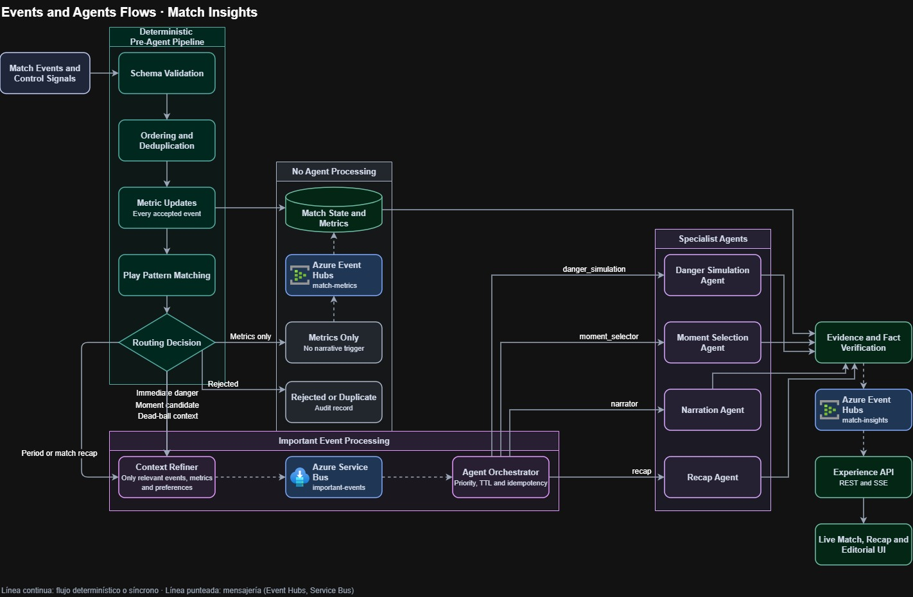
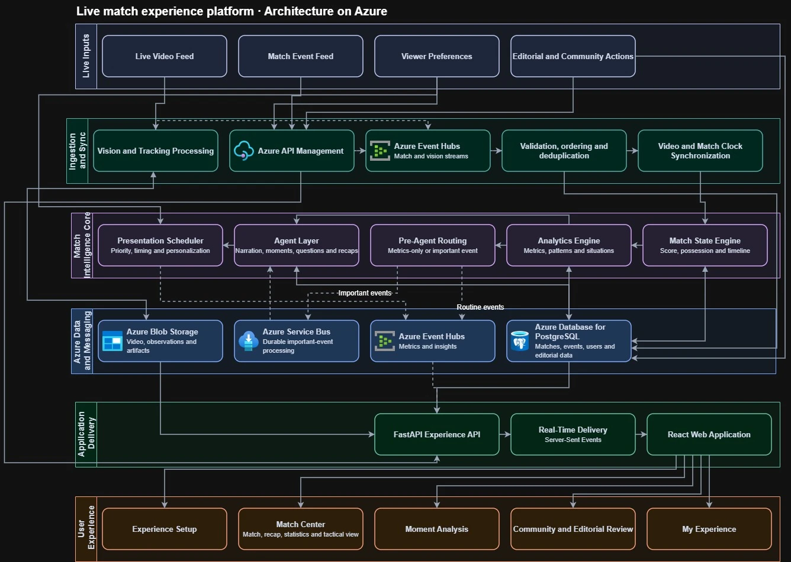
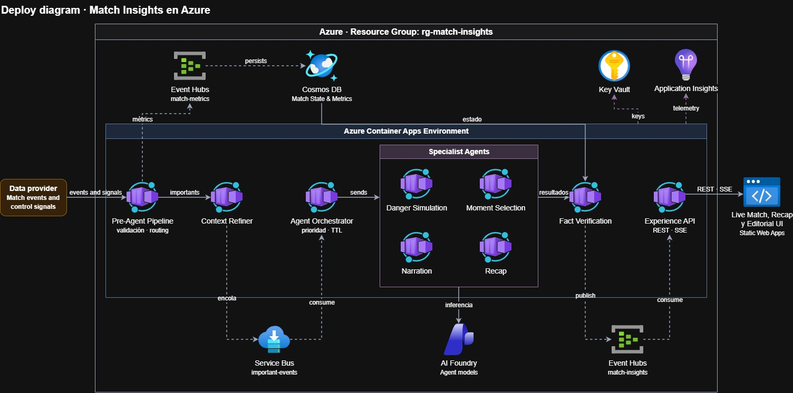
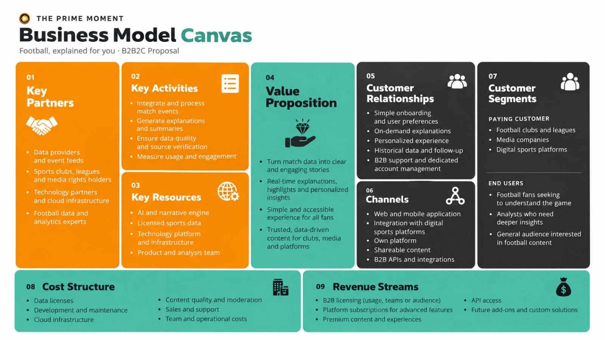

# **The Prime Moment**

**Demo:** <https://ca-mentoxp2-web.politegrass-7d829700.eastus2.azurecontainerapps.io>

El partido con el estadio MESSI es `synthetic-live-001`, en la pestaña Partido del centro del partido. Si la demo estuvo inactiva, la primera carga tarda unos segundos. Antes de reproducir el estadio, TeamSpotting analiza el vídeo durante unos 3,5 minutos.

Monorepo de The Prime Moment, una experiencia que convierte eventos sintéticos de fútbol en explicaciones y momentos personalizados. La [documentación](docs/README.md) contiene el alcance, las decisiones, los casos de uso y el contrato de eventos.

## **Diagramas y modelo de negocio**

Los tres diagramas muestran el diseño objetivo de la plataforma en Azure. La sección [Qué corre hoy en la demo](#qué-corre-hoy-en-la-demo) indica qué parte ya está desplegada.

### **1. Flujo de eventos y agentes**



Cada evento del partido y cada señal de control pasa primero por un filtro determinista, sin IA. El filtro valida el esquema, ordena y descarta duplicados, actualiza las métricas con cada evento aceptado, busca patrones de juego y decide la ruta:

- **Solo métricas:** actualiza el estado y las métricas del partido, que se publican en Event Hubs (`match-metrics`). No llama a ningún agente.
- **Rechazado o duplicado:** queda en un registro de auditoría.
- **Evento importante:** un peligro inmediato, un candidato a momento, un contexto de balón parado o un resumen de período o de partido. El refinador de contexto arma una solicitud solo con los eventos, métricas y preferencias necesarios y la deja en Service Bus (`important-events`). El orquestador la toma según su prioridad, su tiempo de vida y sin repetirla, y la envía al agente especialista: simulación de peligro, selección de momentos, narración o resumen.

La respuesta de cada agente pasa por la verificación de evidencia y hechos, que la contrasta con el estado y las métricas del partido. Lo verificado se publica en Event Hubs (`match-insights`), y la API de la experiencia lo entrega por REST y SSE a la interfaz en vivo, al resumen y a la revisión editorial. La línea continua indica un flujo directo; la punteada, mensajería.

### **2. Arquitectura en Azure**



La plataforma se organiza en seis capas:

1. **Entradas en vivo:** el vídeo, los eventos del partido, las preferencias del espectador y las acciones editoriales y de la comunidad.
2. **Ingesta y sincronización:** el procesamiento de visión y seguimiento, API Management como puerta de entrada, Event Hubs para los flujos de partido y de visión, la validación con orden y sin duplicados, y la sincronización del reloj del vídeo con el del partido.
3. **Núcleo de inteligencia del partido:** el motor de estado (marcador, posesión y línea de tiempo), el motor de analítica (métricas, patrones y situaciones), el enrutamiento previo a los agentes, la capa de agentes (narración, momentos, preguntas y resúmenes) y el planificador de presentación, que decide prioridad, momento y personalización.
4. **Datos y mensajería:** Blob Storage para vídeo, observaciones y artefactos; Service Bus para los eventos importantes; Event Hubs para los eventos de rutina, las métricas y los insights; y PostgreSQL para partidos, eventos, usuarios y datos editoriales.
5. **Entrega:** la API de FastAPI, el envío en tiempo real con Server-Sent Events y la aplicación web en React.
6. **Experiencia de usuario:** la configuración inicial, el centro del partido (partido, resumen, estadísticas y vista táctica), el análisis de momentos, la revisión comunitaria y editorial, y Mi experiencia.

### **3. Despliegue en Azure**



Todo vive en un grupo de recursos. Cada componente del flujo es una Container App dentro del mismo entorno: el filtro previo (validación y enrutamiento), el refinador de contexto, el orquestador, los cuatro agentes especialistas, la verificación de hechos y la API de la experiencia. Entre el refinador y el orquestador, Service Bus guarda los eventos importantes. Event Hubs `match-metrics` lleva las métricas a Cosmos DB, que guarda el estado del partido. Event Hubs `match-insights` lleva los resultados verificados a la API. Los agentes usan modelos de AI Foundry, las claves están en Key Vault y la telemetría va a Application Insights. La interfaz se publica en Static Web Apps.

### **4. Modelo de negocio**



Es una propuesta B2B2C: los clientes que pagan son clubes, ligas, medios y plataformas deportivas digitales, y los usuarios finales son aficionados, analistas y público general. La propuesta de valor es convertir los datos del partido en historias claras, con explicaciones en tiempo real, momentos destacados y contenido personalizado y verificable. El lienzo completa los nueve bloques:

- **Socios clave:** proveedores de datos, clubes, ligas, titulares de derechos, socios tecnológicos y expertos en analítica.
- **Actividades y recursos clave:** procesar eventos, generar explicaciones, verificar fuentes y medir el uso, con un motor de IA y datos con licencia.
- **Relación con el cliente y canales:** configuración simple, explicaciones a pedido, experiencia personalizada, aplicación web y móvil, contenido para compartir y APIs B2B.
- **Costos:** licencias de datos, desarrollo, nube, moderación, ventas y operación.
- **Ingresos:** licencias B2B, suscripciones con funciones avanzadas, contenido premium, acceso a la API y soluciones a medida.

### **Qué corre hoy en la demo**

La demo es una versión reducida del diseño, desplegada con [`infra/azure/deploy-analytics.ps1`](infra/azure/deploy-analytics.ps1):

- **Container Apps:** una sola API de FastAPI, con el filtro, el orquestador, los agentes y la verificación en el mismo proceso. Además corren la interfaz React servida con nginx, el procesador continuo (apagado por defecto) y el trabajo que repite partidos.
- **Datos y mensajería:** Event Hubs (eventos del partido, insights y sala de la comunidad), Blob Storage con el vídeo MESSI, Container Registry, Log Analytics y una identidad administrada. Service Bus está creado, pero la API de la demo todavía enruta los eventos en memoria.
- **Base de datos:** Supabase (PostgreSQL) es el origen de los partidos, y Supabase Auth valida a los editores.
- **Visión:** el estadio usa el vídeo del simulador MESSI con Roboflow y TeamSpotting.
- **Narración:** usa el proveedor provisional; Azure OpenAI se usa en local con `NARRATIVE_PROVIDER=azure`.

Todavía no están desplegados API Management, Key Vault, Application Insights, Cosmos DB, AI Foundry ni Static Web Apps, y los agentes no corren en contenedores separados.

## **Estructura**

- `apps/frontend`: interfaz React en JavaScript, creada con Vite.
- `apps/backend`: API FastAPI en Python con Uvicorn.
- `docs`: decisiones, requisitos e investigación.
- `.agents/skills`: instrucciones del proyecto para futuros agentes.

## **Codex y Context7**

El repositorio incluye una configuración de Context7 para consultar documentación vigente de bibliotecas y frameworks desde Codex. Cada integrante debe autorizar su propia cuenta antes de usarla; no se comparten claves ni sesiones.

Las instrucciones de confianza, autenticación, verificación y solución de problemas están en [`.codex/README.md`](.codex/README.md).

## **Preparación local**

Se necesita Python 3.12, [uv](https://docs.astral.sh/uv/) y una versión de Node compatible con Vite. `uv` puede instalar automáticamente la versión fijada en `.python-version`. Desde la raíz del repositorio:

```bash
npm install
uv python install 3.12
uv sync --project apps/backend --extra dev
```

En una terminal, inicia la API con la configuración local de `apps/backend/.env`:

```bash
uv run --project apps/backend uvicorn match_intelligence.main:app --reload --app-dir apps/backend/src --env-file apps/backend/.env
```

Copia primero `apps/backend/.env.example` como `apps/backend/.env`. El archivo real está ignorado por Git. Usa `NARRATIVE_PROVIDER=provisional` para trabajar sin servicios externos, `fixture` para probar los contratos reales de Persona 3 sin Azure o `azure` para usar los despliegues configurados.

En otra terminal, inicia el frontend:

```bash
npm run dev:frontend
```

La interfaz local aparece en `http://localhost:5173`. Swagger UI está en `http://localhost:8000/docs`. La interfaz reproduce los partidos sintéticos con mensajes sincronizados, preferencias, preguntas, resumen y revisión editorial. También permite simular las seis rutas del filtro, revisar propuestas de recorte y consultar el flujo desde el perfil analista. La experiencia ya puede consumir el módulo de Persona 3 mediante el proveedor configurado; el detalle está en [Persona 4](docs/persona-4-api-y-frontend/README.md).

CrewAI es una dependencia opcional del backend. Para usar la integración con Azure OpenAI, se puede instalar con `uv sync --project apps/backend --extra agents`.

El módulo de la persona 3 ya tiene contratos, un flujo de narración y pruebas con un partido sintético. Consulta la [guía de agentes y narrativa](apps/backend/README-narrativa.md) para ejecutarlo. La API expone las operaciones de narrativa con un proveedor sintético de prueba o con Azure OpenAI si se configura el recurso y los despliegues. El adaptador de la experiencia del partido usa ese mismo flujo sin cambiar los contratos del frontend.

El backend también tiene una primera versión del filtro y el enrutamiento de agentes. La ruta `/api/v1/agent-routing/evaluate` separa eventos de solo métricas y solicitudes relevantes, reconoce dos patrones iniciales y prepara un despacho reproducible. `POST /api/v1/matches/{match_id}/simulation` recorre seis escenarios sintéticos. Todavía no existe almacenamiento persistente ni un canal durable real.

La [colección de Postman](postman/README.md) contiene peticiones y pruebas listas para importar.

## **Demostración integrada de datos y visión**

La demostración reutiliza el backend oficial y una interfaz técnica de validación. No modifica el frontend de producto. Requiere el vídeo permitido y las exportaciones locales de Roboflow Sports, SoccerNet y DV-US-21.

```bash
UV_CACHE_DIR=/tmp/mentox-uv-cache \
uv run --project apps/backend --python 3.12 \
  uvicorn video_sync_diagnostic.app:app \
  --app-dir experiments --host 127.0.0.1 --port 8018
```

Abra <http://127.0.0.1:8018>. La API integrada está en `GET /api/v1/integration/status`, `GET /api/v1/integration/timeline` y `/docs`.

Con Docker:

```bash
docker-compose -f compose.integration.yml up --build
```

El vídeo y los resultados se montan como volúmenes de solo lectura y no se incorporan a la imagen. Para Azure, exporte las variables de `apps/backend/.env.example`; el modo predeterminado sigue siendo `memory`.

La interfaz controla la reproducción de las observaciones ya calculadas. No se
publica nada hasta pulsar **Play**; pausa, salto y reinicio actualizan el cursor
del backend sin volver a presentar el historial como nuevo.

Para iniciar la prueba integrada:

```bash
sudo docker-compose -f compose.integration.yml up --build
```

En Azure, añada antes:

```bash
export VISION_OBSERVATION_TRANSPORT=azure_event_hubs
export EVENT_HUB_FULLY_QUALIFIED_NAMESPACE="<namespace>.servicebus.windows.net"
export VISION_EVENT_HUB_NAME="vision-observations"
export VISION_EVENT_HUB_CONSUMER_GROUP="backend"
```

El reproductor ordena al backend publicar el tramo cruzado. En Azure, el backend
produce en Event Hubs, su consumidor recibe y deduplica, y finalmente WebSocket
actualiza la interfaz. Esta prueba reutiliza inferencias ya calculadas; no vuelve
a ejecutar los modelos.
