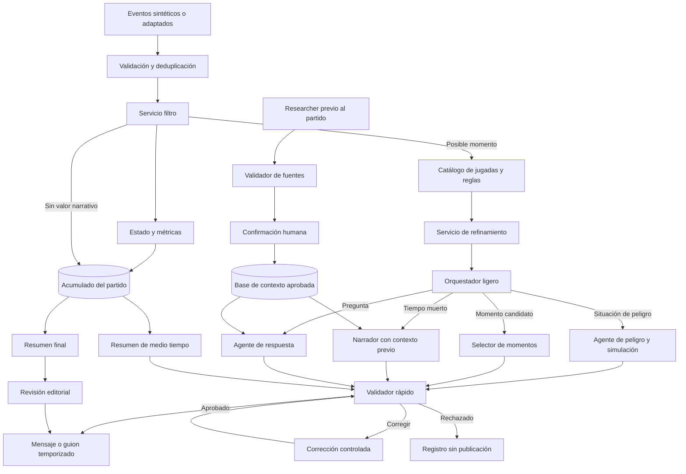
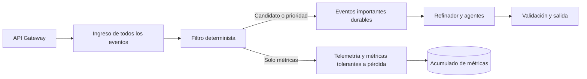

# **Arquitectura de eventos y agentes**

Este documento registra el flujo acordado para procesar el partido mientras se juega. La arquitectura evita enviar cada evento a un modelo de IA. Primero procesa los datos con servicios rápidos y reproducibles. Los agentes reciben solo el contexto necesario para una decisión concreta.

El diseño reemplaza la propuesta inicial de siete agentes independientes. Algunas funciones pasan a ser servicios porque no necesitan un modelo. La implementación actual de cuatro agentes CrewAI es una base de prueba y deberá adaptarse a este flujo.

## **Principios**

**1.** El partido se procesa durante la transmisión. El medio tiempo y el final activan resúmenes, pero las situaciones importantes se analizan y publican mientras ocurre el partido.

**2.** Cada evento aceptado actualiza el estado y las estadísticas. Solo una parte llega al flujo de IA.

**3.** Los servicios calculan marcador, métricas, ventanas de tiempo, reglas de peligro y patrones conocidos. Los modelos seleccionan, explican, relacionan y redactan.

**4.** Cada salida conserva los identificadores de los eventos, métricas, patrones y fuentes que la sostienen.

**5.** Los agentes trabajan mediante eventos y no deben esperar la respuesta de otro agente cuando su tarea sea independiente.

**6.** La personalización es una política compartida por el orquestador, el refinador y el narrador. No será un agente independiente en la primera versión.

## **Flujo propuesto**

## **Tres rutas de transporte**

La ejecución local representa tres rutas lógicas sin exigir servicios de nube:

En Azure, la propuesta es usar API Management como entrada, Event Hubs para el ingreso y la telemetría de alto volumen, y Service Bus para el trabajo importante. Service Bus debe habilitar detección de duplicados, reintentos limitados y cola de mensajes no procesables. Las métricas pueden usar retención corta y reconstruirse desde los eventos originales cuando la política de conservación lo permita.

Esta topología todavía no está desplegada. La implementación actual simula las rutas dentro del proceso y deja contratos reproducibles para validar la conducta antes de pagar o depender de la nube.

## **Servicio filtro de datos**

Este servicio se ejecuta antes del orquestador y no usa un modelo de lenguaje. Debe responder rápido y de forma reproducible.

Recibe `MatchEvent 1.0`, el estado reciente del partido y reglas versionadas. Actualiza siempre las métricas que correspondan y clasifica el evento o la secuencia en una de estas rutas:

**1. Solo métricas.** Actualiza el acumulado y no llama agentes.

**2. Candidato narrativo.** Puede formar parte de un momento que se evaluará después de una ventana corta.

**3. Peligro inmediato.** Activa el análisis de una ocasión peligrosa con mayor prioridad.

**4. Tiempo muerto.** Habilita contenido contextual cuando la narración del partido no tenga prioridad. El contrato actual no representa faltas ni estado detenido. Necesitamos añadir un evento compatible o una señal del reloj y del reproductor antes de implementar esta ruta.

**5. Resumen.** Conserva la contribución para el medio tiempo o el final sin generar una salida inmediata.

**6. Inválido o duplicado.** Se registra y no modifica dos veces el estado.

La salida propuesta es `RoutingDecision v1`. Debe incluir `match_id`, `decision_id`, `route`, `priority`, `reason_codes`, `source_event_ids`, `created_at` y la versión de las reglas. La clasificación no elimina el evento original del almacenamiento durable.

## **Catálogo de jugadas y contexto rápido**

Antes de llamar a la IA, el sistema compara una secuencia con un catálogo versionado de jugadas. El catálogo describe señales observables, datos mínimos, límites y explicaciones permitidas. Ejemplos iniciales: triangulación, recuperación alta, contraataque, progresión rápida, pase al área, tiro bloqueado y balón detenido.

El catálogo no afirma una causa táctica solo por encontrar una forma parecida. Entrega un `PlayContext v1` con el patrón candidato, nivel de coincidencia, señales encontradas, señales faltantes y eventos de origen. El agente recibe este objeto pequeño en lugar de todo el partido.

El acumulado completo permanece disponible para métricas, preguntas y resúmenes. Los agentes consultan ventanas o proyecciones preparadas para su tarea.

## **Servicio de refinamiento**

El refinador convierte la decisión del filtro, el contexto de la jugada, la ventana reciente y las preferencias en un `AgentRequest v1`. Reduce datos repetidos, ordena la evidencia y agrega solo las métricas necesarias.

Este servicio también aplica límites de tamaño, elimina campos que el agente no necesita y conserva enlaces para recuperar evidencia adicional. Si falta información mínima, envía la solicitud al acumulado del resumen o la descarta con un motivo registrado.

## **Orquestador ligero**

El orquestador clasifica una solicitud ya refinada y la publica en la cola del agente correspondiente. Usa GPT-4.1 mini para la clasificación semántica y reglas directas para las rutas evidentes, los límites de seguridad y el control de errores. Nunca recibe los eventos de solo métricas.

Debe devolver `AgentDispatch v1` con agente de destino, prioridad, tiempo máximo, identificador de correlación y razón de envío. Una solicitud puede activar más de una tarea independiente, pero debe evitar duplicados mediante una clave idempotente.

## **Agentes y tareas**

**1. Agente de peligro y simulación.** Explica qué produjo el peligro con evidencia del partido. De forma opcional genera escenarios contrafactuales sobre lo que podría haber ocurrido si una acción cambiaba. Cada escenario debe marcarse como simulación, indicar sus supuestos y no presentarse como predicción ni como hecho. La primera versión puede usar reglas y ramas de jugadas sintéticas. Un modelo probabilístico solo se incorpora después de validar sus datos.

**2. Selector de momentos.** Evalúa candidatos en ventanas configurables durante el partido. Puede esperar hasta dos minutos de tiempo de juego para reunir contexto y emitir el momento cuando exista una pausa adecuada. Un gol o una alerta prioritaria no debe esperar esa ventana.

**3. Narrador.** Prepara el guion a partir de hechos verificados del partido y de la base previa aprobada. Durante el juego prioriza lo que sucede en el campo. En tiempos muertos puede proponer datos de jugadores, estadio, cuerpo técnico, fútbol del país, sucesos recientes autorizados, próximos eventos del canal o promociones.

## **Agente de previa táctica**

El agente de previa es independiente del narrador y del agente contrafactual. Recibe los metadatos de un partido sintético, incluidos equipos y jugadores. Devuelve posibles formaciones para ambos equipos y simulaciones reproducibles con fotogramas ordenados.

Sus instrucciones exigen estas reglas:

**1.** Trabajar solo con los equipos y jugadores recibidos.

**2.** Entregar datos estructurados y no generar HTML ni decisiones visuales.

**3.** Mantener todas las posiciones dentro de una cancha de 0 a 100.

**4.** Producir varias tácticas seleccionables para cada equipo con posiciones de ambos conjuntos, poseedor, recorrido del balón, acción, fase y resultado.

**5.** Marcar cada jugada como simulada. No debe presentarla como hecho ni predicción.

**6.** No modificar eventos, marcador ni estado del partido.

**7.** Consumir información editorial solo desde un documento aprobado. El agente no inventa lesiones, sanciones ni resultados recientes durante la solicitud.

La interfaz puede reutilizar las alineaciones y simulaciones del agente durante un partido en vivo. Las repeticiones de jugadas pasadas no requieren una nueva llamada al agente: se reconstruyen con eventos ya ocurridos y mantienen `source_event_ids`. Las jugadas futuras conservan la marca de simulación y no se mezclan con la evidencia histórica.

La primera implementación es determinista y vive en `apps/backend/src/match_intelligence/application/prematch_agent.py`. La ruta `GET /api/v1/matches/{match_id}/preview` entrega su contrato a la interfaz.

**4. Agente de respuesta.** Responde preguntas con una proyección del estado, métricas y contexto aprobado. Debe indicar cuando la evidencia no alcanza.

**5. Agente de resumen.** Produce un resumen de medio tiempo pensado para una pieza de tres a cuatro minutos y un resumen final más amplio. Recibe el acumulado completo, los momentos seleccionados y las métricas que no se narraron en directo. Los tiempos indicados son objetivos editoriales y deberán validarse con lectura o voz real.

**6. Researcher previo al partido.** Usa GPT-4.1 con una herramienta de búsqueda web para buscar y proponer información antes de la transmisión. Cada dato debe conservar fuente, fecha de consulta, fecha del hecho, alcance de uso y estado de validación. No publica directamente.

**7. Validador de fuentes.** Contrasta las propuestas del researcher, detecta conflictos y entrega datos pendientes para confirmación humana. Solo el contenido aprobado entra en la base que consulta el narrador.

## **Personalización**

La personalización será una configuración común. Incluye idioma, modo casual o analista, nivel de detalle, club favorito, jugador favorito, rol del usuario y canal de salida. El filtro puede usarla para calcular relevancia, el orquestador para priorizar y el narrador para elegir tono y detalle. Ninguna preferencia puede modificar hechos o cifras.

## **Validación antes de publicar**

El validador rápido se ejecuta al final de cada ruta narrativa. Usa reglas para cifras, fuentes y estructura, junto con GPT-4.1 mini para revisar coherencia. Comprueba que las afirmaciones estén en la evidencia, que el texto no mezcle hechos con simulaciones y que la información externa esté aprobada.

Devuelve aprobación, corrección o rechazo. Las correcciones vuelven a validarse y conservan referencia a la versión anterior. El resumen final mantiene además la revisión editorial humana antes de publicarse.

## **Procesamiento por eventos y disponibilidad**

Los servicios se comunican mediante un canal durable. Los eventos se separan por `match_id` para conservar el orden dentro de cada partido y permitir varios partidos en paralelo. Cada consumidor registra su progreso y puede repetir una entrega sin duplicar estadísticas ni mensajes.

El estado del partido y el filtro no dependen de que los agentes respondan. Si un modelo falla, las métricas continúan, la solicitud puede reintentarse dentro de su tiempo útil y luego pasa a una cola de errores. Una narración vencida no se publica fuera de contexto.

El despliegue debe permitir varias instancias sin estado del filtro, refinador, orquestador y agentes. El estado durable, los eventos originales, las decisiones, los contextos aprobados y los resúmenes se guardan fuera de esas instancias. La tecnología concreta del canal y del almacenamiento queda por comparar con pruebas de carga.

## **Estado de implementación**

El backend implementa un flujo CrewAI secuencial con observador, analista, selector y verificador para solicitudes individuales. La experiencia del partido ya puede usar ese flujo mediante un adaptador y elegir despliegues distintos para tareas rápidas y narrativas. También implementa el filtro, el catálogo, el refinador, el despacho y una simulación reproducible de las seis rutas. La interfaz muestra el resultado al perfil analista y permite revisar propuestas de recorte. Todavía no implementa el transporte real con Event Hubs y Service Bus, el corte físico y la carga a Blob, GPT-4.1 mini dentro del orquestador, el researcher, las simulaciones contrafactuales, los resúmenes de medio tiempo ni el despliegue con varias instancias.

El plan de implementación y las pruebas de carga están en [plan de implementación de agentes por eventos](11-plan-implementacion-agentes-eventos.md). La asignación y evaluación de modelos está en [política de modelos de IA](12-politica-modelos-ia.md).
