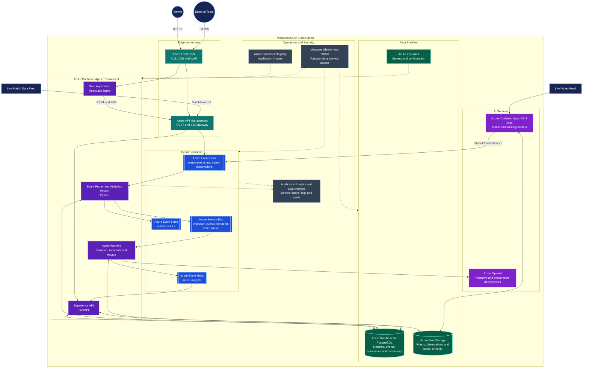

# **The Prime Moment — Azure Architecture Diagrams**

These diagrams describe the Azure architecture blueprint for The Prime Moment. Every diagram uses English labels and follows the project contracts for events, routing, analytics, agent requests and real-time delivery.

## **1. Azure Deployment Architecture**

This view shows the Azure services, deployment boundaries and communication paths. Managed identities and RBAC provide passwordless access between workloads and platform services.

Editable source: [azure-deployment-architecture.mmd](diagrams/azure-deployment-architecture.mmd)

## **2. Agent Orchestration Flow**

This view makes the processing boundary explicit. Validation, deduplication, metric calculation and pattern matching happen before any agent request. Routine events update match state and metrics without entering the agent layer.

```mermaid
flowchart LR
    events[Match Events and Control Signals]

    subgraph preAgent[Deterministic Pre-Agent Pipeline]
        direction LR
        validate[Schema Validation]
        order[Ordering and Deduplication]
        metricUpdate[Metric Updates<br/>Every accepted event]
        patternMatch[Play Pattern Matching]
        classify{Routing Decision}
    end

    subgraph noAgent[No Agent Processing]
        direction TB
        rejected[Rejected or Duplicate<br/>Audit record]
        metricsOnly[Metrics Only<br/>No narrative trigger]
        metricsHub[[Azure Event Hubs<br/>match-metrics]]
        state[(Match State and Metrics)]
    end

    subgraph agentPath[Important Event Processing]
        direction LR
        refiner[Context Refiner<br/>Only relevant events, metrics and preferences]
        queue[[Azure Service Bus<br/>important-events]]
        orchestrator[Agent Orchestrator<br/>Priority, TTL and idempotency]
    end

    subgraph specialists[Specialist Agents]
        direction TB
        danger[Danger Simulation Agent]
        moment[Moment Selection Agent]
        narrator[Narration Agent]
        recap[Recap Agent]
    end

    verify[Evidence and Fact Verification]
    insights[[Azure Event Hubs<br/>match-insights]]
    delivery[Experience API<br/>REST and SSE]
    ui[Live Match, Recap and Editorial UI]

    events --> validate --> order --> metricUpdate --> patternMatch --> classify

    classify -->|Rejected| rejected
    classify -->|Metrics only| metricsOnly --> metricsHub --> state
    metricUpdate --> state

    classify -->|Immediate danger| refiner
    classify -->|Moment candidate| refiner
    classify -->|Dead-ball context| refiner
    classify -->|Period or match recap| refiner

    refiner --> queue --> orchestrator
    orchestrator -->|danger_simulation| danger
    orchestrator -->|moment_selector| moment
    orchestrator -->|narrator| narrator
    orchestrator -->|recap| recap

    danger --> verify
    moment --> verify
    narrator --> verify
    recap --> verify
    state --> verify
    verify --> insights --> delivery --> ui

    classDef input fill:#172554,stroke:#60a5fa,color:#ffffff,stroke-width:2px
    classDef deterministic fill:#0f766e,stroke:#5eead4,color:#ffffff,stroke-width:2px
    classDef bypass fill:#334155,stroke:#cbd5e1,color:#ffffff,stroke-width:2px
    classDef messaging fill:#1d4ed8,stroke:#93c5fd,color:#ffffff,stroke-width:2px
    classDef orchestrate fill:#7e22ce,stroke:#e9d5ff,color:#ffffff,stroke-width:2px
    classDef agent fill:#5b21b6,stroke:#c4b5fd,color:#ffffff,stroke-width:2px
    classDef output fill:#065f46,stroke:#6ee7b7,color:#ffffff,stroke-width:2px

    class events input
    class validate,order,metricUpdate,patternMatch,classify deterministic
    class rejected,metricsOnly bypass
    class metricsHub,queue,insights messaging
    class refiner,orchestrator orchestrate
    class danger,moment,narrator,recap agent
    class state,verify,delivery,ui output
```

Editable source: [agent-orchestration-flow.mmd](diagrams/agent-orchestration-flow.mmd)

## **3. End-to-End Application Flow**

This view connects live inputs, event processing, analytics, agent intelligence, Azure data services, APIs and the complete user experience.

```mermaid
flowchart LR
    subgraph inputs[Live Inputs]
        direction TB
        matchFeed[Match Event Feed]
        videoFeed[Live Video Feed]
        preferences[Viewer Preferences]
        editorialInput[Editorial and Community Actions]
    end

    subgraph ingestion[Ingestion and Synchronization]
        direction TB
        gateway[Azure API Management]
        eventHub[[Azure Event Hubs<br/>Match and vision streams]]
        videoIntel[Vision and Tracking Processing]
        validation[Validation, ordering and deduplication]
        sync[Video and Match Clock Synchronization]
    end

    subgraph core[Match Intelligence Core]
        direction TB
        state[Match State Engine<br/>Score, possession and timeline]
        analytics[Analytics Engine<br/>Metrics, patterns and situations]
        routing[Pre-Agent Routing<br/>Metrics-only or important event]
        agentLayer[Agent Layer<br/>Narration, moments, questions and recaps]
        presentation[Presentation Scheduler<br/>Priority, timing and personalization]
    end

    subgraph platform[Azure Data and Messaging]
        direction TB
        database[(Azure Database for PostgreSQL<br/>Matches, events, users and editorial data)]
        storage[(Azure Blob Storage<br/>Video, observations and artifacts)]
        serviceBus[[Azure Service Bus<br/>Durable important-event processing]]
        insightsHub[[Azure Event Hubs<br/>Metrics and insights]]
    end

    subgraph delivery[Application Delivery]
        direction TB
        api[FastAPI Experience API]
        realtime[Real-Time Delivery<br/>Server-Sent Events]
        web[React Web Application]
    end

    subgraph experience[User Experience]
        direction TB
        onboarding[Experience Setup]
        matchCenter[Match Center<br/>Match, recap, statistics and tactical view]
        momentDetail[Moment Analysis]
        community[Community and Editorial Review]
        profile[My Experience]
    end

    matchFeed --> gateway --> eventHub
    videoFeed --> videoIntel --> eventHub
    eventHub --> validation --> sync --> state
    preferences --> gateway
    editorialInput --> gateway

    state --> analytics --> routing
    routing -->|Routine events| insightsHub
    routing -->|Important events| serviceBus --> agentLayer
    analytics --> agentLayer
    preferences --> presentation
    agentLayer --> presentation --> insightsHub

    validation --> database
    state <--> database
    analytics <--> database
    videoIntel <--> storage
    agentLayer <--> database
    editorialInput --> database

    database --> api
    storage --> api
    insightsHub --> api --> realtime --> web
    gateway --> api

    web --> onboarding
    web --> matchCenter
    web --> momentDetail
    web --> community
    web --> profile

    classDef input fill:#172554,stroke:#60a5fa,color:#ffffff,stroke-width:2px
    classDef ingest fill:#0f766e,stroke:#5eead4,color:#ffffff,stroke-width:2px
    classDef coreNode fill:#5b21b6,stroke:#c4b5fd,color:#ffffff,stroke-width:2px
    classDef platformNode fill:#1d4ed8,stroke:#93c5fd,color:#ffffff,stroke-width:2px
    classDef deliveryNode fill:#065f46,stroke:#6ee7b7,color:#ffffff,stroke-width:2px
    classDef experienceNode fill:#9a3412,stroke:#fdba74,color:#ffffff,stroke-width:2px

    class matchFeed,videoFeed,preferences,editorialInput input
    class gateway,eventHub,videoIntel,validation,sync ingest
    class state,analytics,routing,agentLayer,presentation coreNode
    class database,storage,serviceBus,insightsHub platformNode
    class api,realtime,web deliveryNode
    class onboarding,matchCenter,momentDetail,community,profile experienceNode
```

Editable source: [application-end-to-end-flow.mmd](diagrams/application-end-to-end-flow.mmd)

## **Architecture Notes**

- Azure Event Hubs handles high-volume match, vision, metric and insight streams.
- Azure Service Bus preserves important work with retries, expiration and dead-letter handling.
- Deterministic filtering prevents routine events from consuming agent capacity.
- Agent requests contain only relevant events, metrics, preferences, priority and time-to-live.
- Azure Database for PostgreSQL stores transactional and editorial data.
- Azure Blob Storage stores video, observations and model artifacts.
- Azure OpenAI supports routing and narrative workloads through separate deployments.
- Managed identities and RBAC protect service-to-service access.
- Application Insights and Log Analytics provide end-to-end observability.

