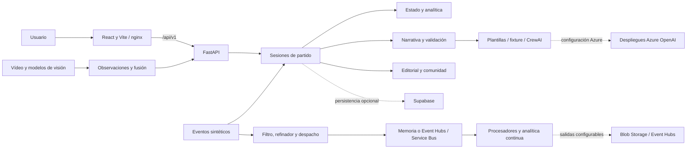

# Arquitectura general

## Vista de componentes

El diagrama reúne caminos presentes en el código; no representa una sola cadena automática ya validada en producción. El flujo de sesiones HTTP, el pipeline de transporte y las observaciones de visión tienen puntos de entrada y estados propios.

## Backend por capas

El paquete `apps/backend/src/match_intelligence/` contiene:

| Capa | Función | Ejemplos |
|---|---|---|
| `domain/` | Contratos y reglas del problema | Eventos, presentación, observaciones, estadísticas y patrones |
| `application/` | Casos de uso y coordinación | Sesiones, replay, pipeline analítico, narrativa, filtro, comunidad |
| `adapters/http/` | API y validación de entrada/salida | Rutas de partido, narrativa, analítica, integración y comunidad |
| `adapters/sources/` | Fuentes sintéticas y conversiones | Escenarios de aceptación, analítica, directo y SoccerNet |
| `adapters/messaging/` | Publicación y consumo | Memoria, Event Hubs, Service Bus y puentes analíticos |
| `adapters/storage/` | Persistencia y artefactos | Supabase, Blob Storage y archivos |
| `adapters/agents/` | Proveedor narrativo | Adaptador de Persona 3 y gateway de CrewAI |
| `adapters/models/` | Modelos de valor | xG, xT y VAEP con carga/configuración explícita |

`main.py` crea FastAPI, registra routers y administra el ciclo de vida de visión/transporte. `registry.py` elige fuentes, analítica y narrativa, y mantiene sesiones en memoria.

## Frontend

`src/screens/` contiene pantallas; `components/`, elementos compartidos; `hooks/`, acceso a catálogo y sincronización; `api/client.js`, llamadas HTTP; `app/`, navegación y preferencias; `styles/`, la presentación.

El router usa `#/...`. La interfaz guarda preferencias en `localStorage`, mientras la API conserva el estado de las sesiones. El reloj de reproducción controla qué eventos, momentos y mensajes se consultan. El campo interpola seguimiento y no convierte una posición simulada en dato observado.

## Peticiones y canales en directo

En desarrollo, el navegador solicita `/api/v1/...` al origen de Vite. `vite.config.js` reenvía `/api` a `process.env.VITE_BACKEND_PROXY` o `http://127.0.0.1:8000`. El cliente no contiene una URL fija de Azure.

En contenedor, nginx sirve el frontend compilado y reenvía `/api/` a `API_UPSTREAM`; `API_HOST` configura el host del backend. Mantiene desactivado el buffering para SSE.

Los mensajes de partido usan SSE. La integración de observaciones dispone de WebSocket y controles de publicación/reproducción. La comunidad utiliza su propio servicio y canal de eventos. Tener varios transportes no garantiza sincronización entre múltiples réplicas sin un bus compartido configurado.

## Persistencia y transporte

Hay dos usos de Supabase: la Data API para guardar la experiencia cuando `SUPABASE_ENABLED=true`, y PostgreSQL mediante `SUPABASE_DB_URL` para carga/lectura de partidos y seguimiento. `MATCH_SOURCE=supabase` elige el segundo camino. Configurar una de estas opciones no activa automáticamente la otra.

Las rutas de transporte separan ingreso, telemetría reconstruible y eventos importantes. En Azure se apoyan en Event Hubs y Service Bus. La idempotencia local del procesador importante utiliza memoria; un reinicio no conserva ese registro.

Blob Storage conserva artefactos y resultados cuando está configurado. Los tres JSON incluidos en `apps/backend/data/vision/` sirven al empaquetado de resultados precomputados; no son una inferencia ejecutada durante el arranque.

## Límites de arquitectura

El código contiene puntos de extensión para IA, modelos y transporte durable. Los servicios remotos requieren recursos, permisos y configuración. El worker predeterminado registra despachos; no debe confundirse con una ejecución completa del narrador o del agente de peligro. La [guía de agentes](agentes.md) y la [validación](../desarrollo/validacion.md) detallan esos límites.
