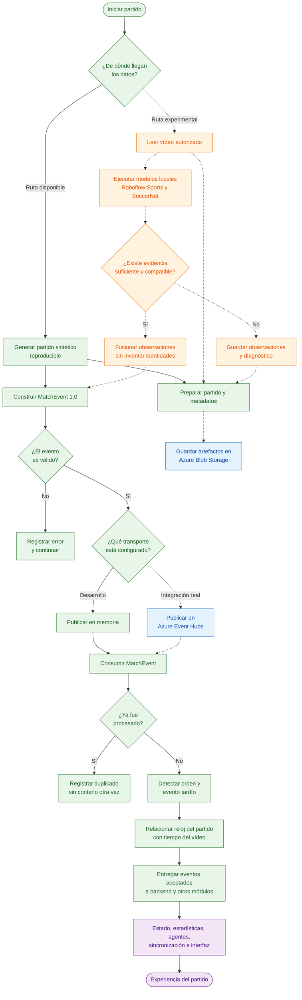

# Flujo de funcionamiento · Persona 1

Este diagrama explica, de principio a fin, cómo funciona lo implementado por Persona 1. El resultado de este módulo es un flujo confiable de eventos normalizados para que las demás partes del sistema puedan calcular estadísticas, generar explicaciones y mostrarlas en una interfaz.

## Flujo completo

## Cómo se lee el diagrama

- **Líneas continuas:** flujo implementado y probado localmente.
- **Líneas discontinuas:** integración preparada o experimental que todavía necesita servicios, modelos o medios reales.
- **Verde:** trabajo implementado por Persona 1.
- **Azul:** integración con Azure preparada, pero pendiente de prueba contra recursos reales.
- **Naranja:** procesamiento de vídeo pendiente de ejecutar y calibrar con un vídeo autorizado.
- **Morado:** trabajo que continúa en los módulos de otras personas del equipo.

## Qué ocurre en cada etapa

### 1. Se elige la fuente

El sistema puede trabajar con dos rutas:

- El **generador sintético**, que ya funciona y produce siempre el mismo partido cuando recibe la misma semilla.
- Un **vídeo autorizado**, que será procesado por modelos locales cuando esa integración sea probada con material real permitido.

La ruta sintética mantiene operativa la demostración aunque Azure o los modelos de visión no estén disponibles.

### 2. Se crea un evento común

Todas las fuentes deben terminar produciendo un `MatchEvent 1.0`. Este es el formato común para representar pases, tiros, entradas, presión, recuperaciones y cambios de posesión.

Roboflow Sports aportaría detecciones, posiciones y seguimientos. SoccerNet aportaría candidatos de acciones y sus tiempos. La lógica de fusión solo puede crear un evento cuando ambas observaciones sean compatibles y exista evidencia suficiente.

### 3. Se controla la calidad

Cada evento pasa por las siguientes comprobaciones:

1. Validación del contrato y sus campos obligatorios.
2. Detección de duplicados después de recibirlos, mediante `match_id` y `event_id`.
3. Detección de eventos tardíos o fuera de orden.
4. Registro de errores sin detener el procesamiento de los siguientes eventos.

Un evento inválido o duplicado no se entrega como un evento nuevo.

### 4. Se selecciona el transporte

El mismo flujo puede usar uno de estos adaptadores:

- **Memoria local:** se usa para desarrollo y pruebas sin depender de servicios externos.
- **Azure Event Hubs:** transportará los eventos entre productores y consumidores durante la integración real.

El cambio se realiza mediante configuración. El generador y el contrato deportivo no dependen directamente de Azure.

### 5. Se guardan los artefactos

Azure Blob Storage se utilizará para guardar:

- partidos sintéticos;
- vídeos autorizados;
- observaciones producidas por los modelos.

Cada artefacto conserva metadatos, procedencia y un hash SHA-256 para comprobar su integridad. Blob Storage guarda archivos; Event Hubs transporta eventos.

### 6. Se entrega el resultado

Persona 1 entrega eventos aceptados y trazables. A partir de ellos, los siguientes módulos podrán:

1. actualizar el estado del partido;
2. calcular estadísticas y detectar momentos importantes;
3. generar y verificar explicaciones;
4. mostrar mensajes sincronizados en la interfaz.

Estas etapas aparecen en morado porque pertenecen al flujo general del producto, pero no forman parte de la responsabilidad directa de Persona 1.

## Estado actual

La ruta sintética completa funciona localmente: generación, reproducción, validación, duplicados, eventos tardíos, transporte en memoria y entrega al consumidor.

Los adaptadores, scripts y la infraestructura de Azure están preparados. Todavía falta desplegar los recursos y realizar una prueba real de Event Hubs y Blob Storage.

La evaluación, protección de identidad y fusión de observaciones están implementadas con datos de prueba. Todavía falta ejecutar Roboflow Sports y SoccerNet con un vídeo autorizado, medir sus resultados y decidir si su calidad permite incorporarlos a la demostración.

Este flujo utiliza datos sintéticos y no redistribuye material real de partidos de la Premier League.
